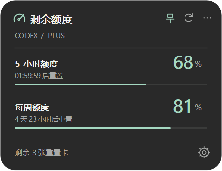

# codex_quotaleaf

**把 Codex 剩余额度放在桌面上。**

一张可固定位置、可更换背景、可等比例缩放的 Windows 桌面卡片。
使用本机已登录的 Codex 查询额度，任务运行时默认每 **3 秒**刷新，无运行任务时默认每 **5 分钟**刷新，随时查看剩余百分比与重置倒计时。



> 预览使用演示数据，不含实际账号额度或个人背景图片。显示的是 **Codex 套餐额度**，不是 ChatGPT 所有模型的剩余消息数，也不是 API 余额。

## 功能

| 功能 | 说明 |
| --- | --- |
| 查看额度 | 显示账号返回的 5 小时、每周等窗口，支持切换额度分组 |
| 智能刷新 | 运行时默认 3 秒，无运行任务时默认 300 秒，两项独立设置；检测到运行任务后立即刷新 |
| 任务状态 | 底部显示任务数量，每秒独立检测，优先级为等待确认 > 已完成 > 正在运行 |
| 任务通知 | 完成或可识别的等待确认事件发送托盘通知，可在设置中关闭 |
| 鼠标穿透 | 不挡下方窗口，快捷键或托盘可恢复操作 |
| 全局快捷键 | 默认 Ctrl+Alt+Q，可改为 Ctrl / Alt / Win 加字母或数字 |
| 迷你模式 | 144×58 两行小胶囊（100% 缩放），上排双额度，下排任务状态与更多菜单；双击空白处展开 |
| 低额度提醒 | 剩余 **低于 20%** 时，百分数与进度条变红 |
| 额度重置卡 | 左下角显示剩余张数，在二级菜单选择卡片并确认使用 |
| 等比例缩放 | 50%–250%，文字、图标、图片与间距同步缩放，不支持拉伸 |
| 个性化 | 背景图、背景透明度、遮罩深度、主题、强调色及主卡片圆角 |
| 固定位置 | 拖动、边缘吸附、位置锁定、切换置顶 |
| 紧凑显示 | 标准 / 紧凑模式，可隐藏重置倒计时 |
| 桌面常驻 | 系统托盘、可选开机启动，默认不开启自启动 |

背景透明度只影响背景，文字保持清晰。主卡片无外边框；菜单独立使用 10 像素小圆角。

## 开始使用

### 环境要求

- **Windows 10 / 11**，其他系统尚未验证。
- **Python 3.10+**，包含 `pip`。
- 已安装 [OpenAI Codex](https://github.com/openai/codex)，并使用 **ChatGPT 账号**完成登录。
- 可以访问 Codex 服务的网络连接。

### 安装

```powershell
git clone https://github.com/N1ce2/codex_quotaleaf.git
cd codex_quotaleaf

python -m venv .venv
.\.venv\Scripts\python.exe -m pip install -r requirements.txt
.\.venv\Scripts\python.exe quota_card.py
```

没有 Git 时，可点击本仓库 **Code → Download ZIP**，解压后在项目目录执行后三条命令。

### 日常启动

安装依赖后，双击 **`launch.vbs`** 或 **`启动额度卡片.vbs`** 即可启动，不弹出终端窗口。
启动器优先使用项目内 `.venv`，否则使用 PATH 中的 `pythonw.exe`。

目前提供源码运行方式，尚无独立 `.exe` 安装包。请保留整个项目文件夹，不要只复制启动器。

## 操作指南

| 操作 | 效果 |
| --- | --- |
| 拖动卡片空白处 | 移动位置，靠近屏幕边缘时吸附 |
| 双击空白处 / 点击齿轮 | 打开个性化设置 |
| 点击图钉 | 切换始终置顶 |
| 点击刷新图标 | 立即查询额度 |
| 点击左下角“剩余 x 张重置卡” | 展开卡片菜单，查看简短名称、到期日并选择使用 |
| 点击三个点 / 右键卡片 | 锁定、紧凑模式、更换背景、隐藏和退出 |
| 点击系统托盘图标 | 恢复隐藏的卡片 |
| Ctrl+Alt+Q | 普通模式显示 / 隐藏；穿透模式临时恢复操作 / 再次穿透 |
| 点击底部任务状态 | 同优先级仅一个任务时直接跳转；两个及以上才展开选择菜单；等待确认 / 已完成打开后清除提醒，运行中保留显示 |
| 更多菜单 → 迷你模式 | 切换迷你卡片；紧凑模式偏好保留 |
| 更多菜单 → 退出卡片 | 退出界面并关闭自身启动的查询服务 |

设置中可分别调整运行时刷新（3–3600 秒）、无运行任务时刷新（3–86400 秒），以及快捷键、鼠标穿透、任务通知和外观。勾选“登录 Windows 时自动启动”可启用自启动，取消勾选可关闭。

### 任务状态与省电刷新

- 每个本地会话计作一个任务，不将工具调用和子代理重复计数。
- “已完成”只计卡片启动后完成、尚未打开查看的任务；不会把全部历史记录计入。该会话开始新任务后，旧完成提醒自动移除。
- 等待确认优先于已完成，已完成优先于运行中。点击时只选择当前最高优先级的一类：仅一个直接通过官方 `codex://threads/<thread-id>` 链接返回对应 Codex 会话；两个及以上显示该类任务的选择菜单。例如一个已完成加一个运行中，只打开已完成的任务，不弹菜单。
- 打开“正在运行”的任务只跳转，不清除显示，可重复点击返回。“等待确认 / 已完成”打开后只清除所选任务本次状态的提醒，不清除其他任务；任务进入新状态或新一轮后可再次提醒。系统无法接收任务链接时保留提醒并提示错误。
- 迷你模式将任务文字简写为“待确认 x / 完成 x / 运行 x”，悬停可看完整说明。确认操作仍需回到 Codex 执行，卡片不会批准命令或代答问题。
- 任务检测每秒在后台独立进行；有任务从闲置转为运行时，立即查询额度并恢复运行刷新间隔。等待确认但没有运行任务时使用闲置间隔。手动刷新始终立即查询。
- 任务源为当前 `CODEX_HOME`（默认 `~/.codex`）下的本地任务索引与会话事件，只读打开，不保存聊天内容。只覆盖本机可见会话，不代表其他设备或云端任务。
- **兼容性限制：** Codex 本地索引属于内部格式，升级可能影响读取。等待确认只识别本地记录中明确存在的输入 / 审批请求；未写入本地事件的授权弹窗无法保证识别，不会把“工具执行较慢”猜成等待确认。读取失败显示“任务状态不可用”，并保守使用运行刷新间隔。
- 全局快捷键使用 Windows 的快捷键注册接口，不安装键盘钩子、不记录按键。快捷键冲突会提示，可从托盘进入设置更改。穿透默认关闭；开启后用快捷键或托盘恢复鼠标操作。

“固定位置”通过锁定与置顶实现，卡片不是嵌入壁纸的 Windows 桌面组件。

### 使用额度重置卡

点击左下角入口，在就地弹出的菜单中选择重置卡，不会打开独立详情窗口。菜单只显示简短名称和到期日；展开某张卡后点击“确认使用此卡”才发出请求。
使用成功会重新读取额度与卡片数量。没有符合条件的额度、卡片失效或服务暂未提供详情时，会显示对应提示。

可用张数以服务端 `availableCount` 为准，详情列表可能只返回其中一部分。未知数量显示 `—`，不当作 0 张；离线、陈旧缓存及过期卡片不能使用。
网络中断或超时时，不自动重复使用；同一张卡的不确定重试会复用原请求标识。实际重置范围以卡片说明和服务端结果为准，使用后不可撤回。

## 额度如何读取

```text
桌面卡片 → 本机 Codex App Server → 当前 Codex 登录账号的额度
```

- 使用官方 `account/rateLimits/read` 只读接口，兼容 `account/rateLimits/updated` 通知。
- 剩余百分比按 `100 − usedPercent` 计算，不将已用额度误认为剩余。
- 不发送模型对话、不充值。只有选择重置卡并确认后，才调用 `account/rateLimitResetCredit/consume` 使用所选卡片。
- 登录与凭据处理交给本机 Codex，应用不复制账号密码或访问令牌。
- 未知额度显示 `—`；倒计时归零后等待服务端响应，不擅自设为 100%。
- 请求未完成时不会重叠查询；网络失败后保留上次数据，标注连接状态并自动重连。
- 3 秒是运行任务时的默认查询间隔，闲置时默认 300 秒；不保证服务端在每次查询时都产生新数据，遇到网络延迟或限流时以实际响应为准。

官方接口说明：[Codex App Server](https://learn.chatgpt.com/docs/app-server)。
任务链接说明：[官方 Deep links 文档](https://learn.chatgpt.com/docs/reference/commands#deep-links)。

## 本地文件与隐私

首次运行后，配置与额度缓存保存在 `state/` 中：

| 文件 | 用途 |
| --- | --- |
| `settings.json` | 外观、位置、背景图片路径与刷新间隔 |
| `usage-cache.json` | 最近一次额度响应和同步时间 |
| `instance.lock` | 防止重复运行 |
| `reset-attempts.json` | 保存不确定重置请求的标识，重试时避免重复消耗 |
| `error.log` | 程序异常时生成的诊断信息 |

**`state/`、虚拟环境、`.env` 和本地截图已加入 `.gitignore`。**
反馈问题前请检查日志、配置和截图，去除账号信息及背景图片的个人路径。

## 常见问题

**找不到 Codex**

确认终端可以执行 `codex --version`。安装 Codex 或修正 PATH 后重新启动卡片。应用也会检查 Codex 桌面应用的本地安装位置。

**没有额度 / 提示需要登录**

先在本机 Codex 中使用 ChatGPT 账号完成登录。API key 登录不等于 ChatGPT 套餐登录，不保证返回卡片需要的额度。

**卡片隐藏后找不到**

检查 Windows 任务栏右侧系统托盘，点击额度卡片图标恢复。已有实例时不需要重复启动。

**双击启动器没有窗口**

在项目目录执行 `.\.venv\Scripts\python.exe quota_card.py` 查看错误，并确认依赖已安装。如果存在 `state/error.log`，可检查其中的异常信息。

**网络连接失败**

确认 Codex 本身可正常连接服务。如需代理，让启动卡片的环境使用相同的代理设置。遇到服务限流时可增大刷新间隔。

**背景图片不显示**

原图仍从原路径读取，不会复制到项目。原图被移动或删除后，请重新选择 PNG、JPG、WebP 或 BMP 文件。

## 开发与验证

```powershell
# 额度换算、空值、多分组与重置倒计时测试
.\.venv\Scripts\python.exe -m unittest discover -s tests -v

# 可选：查询真实额度并退出，会短暂显示窗口
.\.venv\Scripts\python.exe quota_card.py --probe
```

使用 **Python + PyQt5** 原生桌面界面，通过标准输入/输出与本地 Codex App Server 交换 JSON 消息。

```text
codex_quotaleaf/
├── quota_card.py        # 卡片、设置与额度查询
├── reset_cards.py       # 重置卡详情和使用确认
├── task_status.py       # 本地任务状态与刷新策略
├── desktop_controls.py # Windows 全局快捷键
├── requirements.txt    # Python 依赖
├── launch.vbs          # Windows 无终端启动器
├── quota-card.ico      # 应用图标
├── docs/preview.png    # 演示数据界面预览
└── tests/test_quota.py  # 额度逻辑测试
```

欢迎在 [Issues](https://github.com/N1ce2/codex_quotaleaf/issues) 反馈建议或问题。请提供 Windows、Python、Codex 版本与复现步骤，并去除私人信息。

---

这是独立的个人项目，与 OpenAI 无隶属或背书关系。Codex 与 ChatGPT 名称属于其各自权利人。
